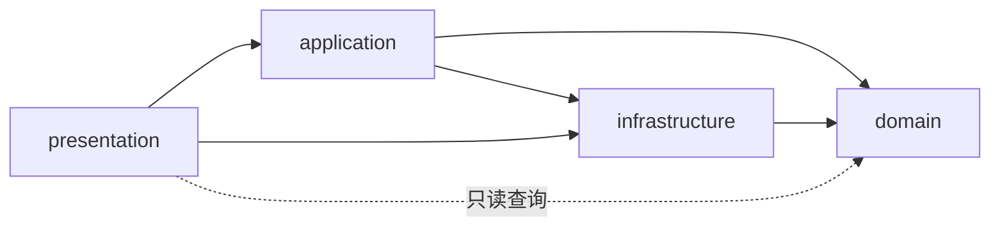

# 架构

> 适用范围：当前代码的模块职责、依赖边界、权威状态、持久化与构建方式；未实现能力单列为预留。
> 何时读取：新增／移动模块、修改跨层接口、状态协调、构建或部署方式前。
> 最后更新：2026-10-23

## 1. 技术栈与入口

| 领域       | 当前选择                                                         |
| ---------- | ---------------------------------------------------------------- |
| 界面与类型 | React 19、TypeScript严格模式；Motion、CSS、内联SVG与Web Audio。  |
| 构建       | Vite 6、npm锁文件；Node.js 24.x ≥24.22.1 或26.x ≥26.12.1。       |
| 验证       | Vitest、Prettier、Playwright；门槛见[testing.md](./testing.md)。 |

`main.tsx`以React.StrictMode挂载`presentation/App.tsx`。App用内存中的home／classic／contest选择页面，无路由、后端或额外状态管理库。经典Hook保持挂载以保留进度和共享设置；进入竞赛时显式开始新Match，正常页面选择标准含道具BO5开发预设。

## 2. 分层与依赖方向（严格）

| 层                | 职责与边界                                                                                        |
| ----------------- | ------------------------------------------------------------------------------------------------- |
| `domain/`         | 纯TypeScript的规则、合法命令、状态转换和观察投影；不依赖React、浏览器或其他层，随机源由外部注入。 |
| `application/`    | 持有权威状态，协调命令、提交、回放、输入锁和取消；调用基础设施，不依赖表现层。                    |
| `presentation/`   | React组件、样式及双语文案；消费应用视图和领域只读查询，不自行结算或直接访问localStorage。         |
| `infrastructure/` | 存档校验／读写和音效；可调用领域纯函数，不依赖React、应用或表现层。                               |

- classic与contest拥有独立引擎和命令类型，彼此不导入；竞赛不通过经典transition的mode分支实现。
- 经典保留52张扑克牌、A点数、金额／下注及其测试助手；竞赛独立建模数字实例和Match／Game／Round／Turn。经典规则经`rules`逐调用注入，竞赛规则在Match开始时复制校验并冻结。
- `domain/shared/`与`application/shared/`仅在两模式有实际消费者时提取最小工具，目前只有职责说明；不提前统一CardId、计分或保存生命周期。
- `architecture.test.ts`检查导入解析、分层、模式隔离及真实生产入口的递归依赖。竞赛执行定义和预设按明确文件白名单准入；prototype、实验预设、图鉴数据模块及测试助手不进入生产图，无法静态证明隔离的动态导入／glob不放行。

## 3. 模块职责

| 路径                                                | 职责                                                                                                                  |
| --------------------------------------------------- | --------------------------------------------------------------------------------------------------------------------- |
| `src/domain/classic/`                               | 经典transition、legalActions、score、逐手结算与历史汇总；同目录保留固定牌序助手和测试。                               |
| `src/domain/contest/engine/`                        | Round与Match转换、积分／生命周期、资源和数字实例、效果／触发／逆操作、合法命令及观察／事件投影。                      |
| `src/domain/contest/trumps/`                        | 稳定ID、双语键与来源元数据、唯一执行定义及准入集合。                                                                  |
| `src/domain/contest/presets/`                       | 五档数量、准入过滤及冻结的标准开发配置；experimental仅用于历史实验。                                                  |
| `src/domain/contest/ai/`                            | 仅消费观察与合法动作的Hit／Stay基线策略。                                                                             |
| `src/domain/contest/codex/`                         | 图鉴查询、进度更新及子负载校验的纯数据API，尚未接页面或持久化。                                                       |
| `src/application/classic/useGame.ts`                | 经典权威信封、保存／冲突处理、展示状态及动画队列。                                                                    |
| `src/application/contest/`                          | coordinator私有持有Match；controller限制玩家命令；useContest适配React订阅、偏好、音效及可见性；random提供独立随机流。 |
| `src/infrastructure/classic/`、`shared/audio.ts`    | 经典存档与共享设置信封、Web Audio。                                                                                   |
| `src/presentation/App.tsx`、`shell/`                | 模式入口、两模式组装和统一弹层；弹层协调竞赛暂停／恢复。                                                              |
| `src/presentation/classic/`、`contest/table/`       | 经典桌面／面板；竞赛数字牌、道具选择、留场、操作和公开反馈。                                                          |
| `src/presentation/shared/`、`i18n.ts`、`styles.css` | Modal／Icon、系统减少动态偏好、en／zh-CN字典与响应式样式。                                                            |

测试与实现同目录，使用`*.test.ts`；可复用专项实验在`scripts/validation/`。行为细节和资料在`docs/design/`，存档字段在`docs/contracts/`，需求范围与验收证据在`docs/requirements/`。`node_modules/`、`dist/`、`output/`为忽略的生成内容。

## 4. 构建与部署

- `npm run dev`启动127.0.0.1:5173；`npm run build`执行`tsc -b`和Vite；`npm run preview`在127.0.0.1:4173预览产物。
- `vite.config.ts`保留`base: "./"`与vite-plugin-singlefile，JS／CSS内联到`dist/index.html`，favicon外置；版本由package.json注入`__APP_VERSION__`。
- CSP插件在singlefile内联完成后，对换行规范化的最终脚本文本计算SHA-256并写入策略，meta始终位于脚本之前。生产`connect-src 'none'`；开发增加本机WebSocket与self以支持HMR。
- [CI](../.github/workflows/ci.yml)在main／codex/**推送、PR或手动触发时，运行high／critical依赖审计，以及Node 24.22.1／26.12.1矩阵的测试和构建。通过升级修复依赖公告，不降低审计等级或抑制公告；Actions固定commit SHA，经Dependabot PR更新。[Dependabot](../.github/dependabot.yml)每周检查npm及Actions依赖。
- 产物可通过file://直接打开，或部署到静态HTTP／HTTPS主机的根／子目录；无客户端路由回退或Service Worker。单文件分发约束见[ADR-002](./adr/ADR-002-singlefile-release-build.md)。

## 5. 权威状态与回放

| 模式 | 一次命令的数据流                                                                                                                                                           |
| ---- | -------------------------------------------------------------------------------------------------------------------------------------------------------------------------- |
| 经典 | useGame.send → 领域transition计算终态与事件 → persist先保存权威信封 → 按事件快照更新React展示 → 落定终态并解锁。                                                           |
| 竞赛 | controller.send → coordinator调用transitionMatch完成命令及触发链 → 提交私有Match终态 → projectMatchTransition生成授权事件／快照 → 回放结束后按权威行动方恢复输入或调度AI。 |

经典权威信封存于useGame的ref，reducer只管理展示；跨标签冲突中止提交，存储写入失败则保留内存进度并提示导出。竞赛由coordinator私有持有Match，useContest通过useSyncExternalStore订阅；公开snapshot也只返回human观察。controller仅开放玩家命令，不向页面暴露协调器的双方受控端口。

动画和音效只重放已计算快照，不决定赔付、积分或行动方。PlayTrump及其触发链原子执行且保留当前Turn，Hit／Stay才交权；NextRound继续已结算的回合／局，不由继续按钮重新判胜。

回放／AI思考／暂停期间拒绝输入。generation使已取消回调失效，inputId使旧目标／费用选择失效；暂停、跳帧、退出与重开均处理取消，恢复后重新观察。effectId在协调器生命周期内单调递增。公开recentEvents最多保留48条授权反馈，暂停／跳帧补齐已提交反馈，换Round／重开／退出清理；这些事件不构成持久化战绩。

## 6. 道具、信息与随机边界

- `trumps/numberDefinitions.ts`与`interactionDefinitions.ts`是唯一执行数据，`admitted.ts`聚合生产集合，`catalog.execution`引用同一对象。道具目录登记54个条目，53个具备已准入执行定义；回仙只有元数据和恢复次数契约，待主动技实现后准入。
- 应用显式选择`presets/s2.ts`的`s2-development`标准配置；引擎默认仍可创建无道具比赛，核心引擎入口不导入目录或预设。每场冻结规则、执行定义和资源配置，初始化校验先于随机消费。
- 活道具位于库存／手牌，出卡与费用销毁后仅留审计；TableEffect是独立效果记录。数字实例区分初始与生成来源，同值可有不同ID。资源、数字贡献、积分与生命周期始终经同一引擎执行，不能由UI或AI另算。
- 悔牌按已提交事务的EffectDelta作逆操作，不回滚整场快照、费用、随机游标或已知信息；恢复删除内容使用新实例ID。单次命令只遍历有限定义、既有记录和事务差量，领取不递归出卡。
- UI／AI只接按接收者权限重建的观察与逐事件投影；暗牌、未公开道具及费用身份仅向有权限的一方提供，库存顺序和撤销差量不透传。合法目标基于授权信息，公开揭示与私有窥序分别投影；显示原值与有效贡献分开，页面不重算胜负。
- `application/contest/random.ts`为数字洗牌、Hit门控、道具选取建立惰性初始化且独立推进的流，领域也接受显式注入。当前AI仅按自身总和＜17且可Hit时Hit，否则Stay，不主动用卡且无随机端口；后续搜索采样须与真实随机隔离。

## 7. 持久化与预留能力

经典使用`green-room.blackjack.v1`键，SaveEnvelope的version／rulesVersion均为2，保存完整game及共享语言、音量、静音和动态偏好。导入先校验再替换，不支持版本明确拒绝；旧键保留旧档检测能力。校验与格式见[经典存档契约](./contracts/save-format.md)。

竞赛对局只在内存中，刷新／退出即放弃；controller、Hook与策略不读写竞赛存档。共享偏好继续经经典设置API保存，图鉴纯数据API不等于已接入浏览器存储。

`infrastructure/contest/`、难度／图鉴／自定义页面及技能／组合AI仍有预留工作，目录README表示职责而非已交付能力。未来元进度使用独立键、版本与冲突处理，写入失败不回滚内存牌面；技能次数／待办不保存，技能ID不混入道具图鉴负载。实施范围与顺序见[roadmap](./roadmap.md)，元进度格式仍为[契约草案](./contracts/contest-save-format.md)。

## 8. 设计依据与导航

- [ADR索引](./adr/README.md)：规则参数化、单文件分发和模式隔离的决策理由；竞赛共享边界与信息隔离以[ADR-004](./adr/ADR-004-contest-turns-and-shared-boundaries.md)为准，其部分取代ADR-003。
- [设计索引](./design/README.md)：规则、状态与动画、UI、持久化及图鉴数据的详细行为。
- [需求索引](./requirements/index.md)：各项需求的实现与验收证据；本文件按当前架构维护，不追加实施历史。
